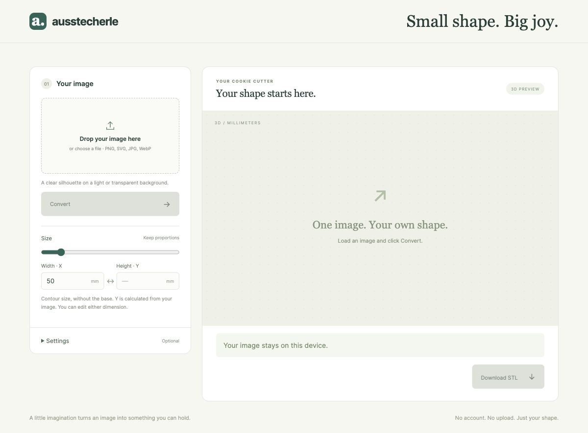
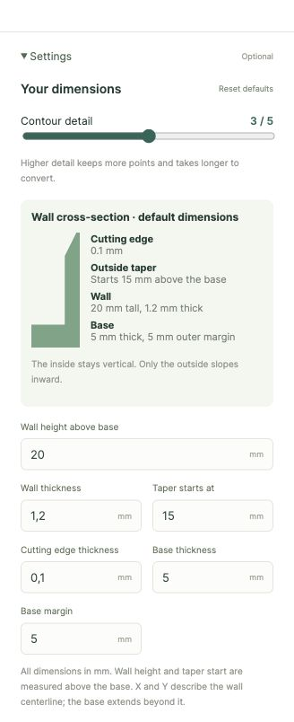

# Ausstecherle

Ausstecherle turns a PNG, SVG, JPG, or WebP silhouette into a 3D-printable cookie cutter. Choose an image, set the size, and click **Convert** to preview the cutter and download an STL. **Settings** lets you adjust contour detail, wall thickness, the outside taper, and the base. The wall facing the cookie stays vertical. Bevels face outward at the rim and inward at cutouts. Enclosed cutouts, such as the eyes, nose, and mouth in the smiley example, get three base-level supports each. Base Thickness sets their height and Base Margin sets their width. Images are processed locally in the browser.

## Run locally

Install Node.js 22.12+ or 20.19+, then run from the repository root:

```sh
npm ci
npm run dev
```

Open the URL printed by Vite. Try a silhouette from [examples](examples/).

For static hosting, run `npm run build` and serve the contents of `dist/`. On a Docker host with the shared `caddy` network, run `docker compose up -d --build` and add the site to your existing Caddy configuration using [the example](docker/Caddyfile.example).

## Screenshots

<p>
  
  
</p>
